# 饲料供应链数据分析作品集报告

**面向岗位**：通威农发 · 供应链数据分析师
**主题**：买得明白（P1 原料成本监测）、验得快速（P2 进厂 NIR 快检）、送得经济（P3 旺季生产库存配送优化）
**共用底座**：星型模型（SQLite）+ 指标字典（24 条）+ 假设登记表（21 条）+ 最低成本配方模型（LP）

> 数据诚实声明：期货行情（豆粕/玉米/菜粕，2022-07 至 2026-10，9124 条）与玉米 NIR 数据集（80 样本×3 仪器×700 波长）为真实数据；现货基差、鱼价、鱼粉价格、工厂产能、订单等为模拟或假设值，逐条登记在《假设登记表》中，报告中以【模拟】【假设】【待核】标注。

---

## 〇、总体设计

| 作品 | 供应链环节 | 回答的问题 | 主要方法 |
|---|---|---|---|
| P1 原料成本监测与采购决策支持 | 采购 | 原料涨了，吨成本涨多少？怎么应对？ | 指标体系、星型模型、配方 LP、套保回测 |
| P2 原料进厂 NIR 快检 | 进厂质检 | 这批原料营养值多少？能不能收？测准值多少钱？ | PLS、异常样本拦截、仪器间校正、配方模型算收益 |
| P3 旺季生产、库存与配送优化 | 生产计划/库存/配送 | 产能运力够不够？怎么备货？怎么送最省？ | 需求测算、多期 LP、车辆排线（Clarke-Wright）、情景分析 |

三个作品共用同一套维度表（日期/原料/地区/工厂/数据源）、同一本指标字典、同一个配方模型——这对应岗位 JD 第 2 条"数据治理与指标口径"：口径只定义一次，全链路复用。

---

## 一、公共底座

### 1.1 星型模型

`data/supply_chain.db`（SQLite），5 张维度表 + 7 张事实表：

- **维度表**：`dim_date`（1826 天，含旬/周/养殖季节标签：投苗期 3-5 月、旺季 6-10 月、越冬期 11-2 月）；`dim_ingredient`（12 种原料的营养值与基准价）；`dim_region`（四川 17 市 + 重庆，坐标与需求权重）；`dim_factory`（4 家示例工厂，产能与仓容为假设值【待核】）；`dim_source`（8 个数据源，含可信度等级 A/B/C）。
- **事实表**：`fact_futures_daily`（9124 行真实行情，含主力标记）、`fact_price_weekly`（3723 行指标长表）、`fact_formula_cost_weekly`（438 行）、`fact_nir_result`、`fact_demand_monthly`、`fact_shipment_plan`、`fact_inventory_plan`。

### 1.2 指标字典与假设登记表

- 《指标字典》24 条：每条含业务含义、公式口径、统计粒度、更新频率、数据源、剔除规则、负责部门（假设）、版本号。例如 P1-08"饵料成本占鱼价比"明确注明"未含加工费与饲料厂利润，低估真实饲料成本"。
- 《假设登记表》21 条：每条含取值/区间、依据、影响的结论、灵敏度测试。面试官问"这个数从哪来"，翻这张表即可回答。

### 1.3 最低成本配方模型（PuLP 线性规划）

12 种原料、6 项营养约束（粗蛋白/粗脂肪/粗纤维/赖氨酸/蛋氨酸/总磷）、用量上限由抗营养因子决定（棉粕游离棉酚、菜粕硫苷），另有淀粉粘合下限。基准价下两个料种的最优解：

**草鱼料（吨成本 2479 元/吨）**：菜粕 35.0%、棉粕 20.0%、米糠 15.0%、玉米 14.4%、豆粕 8.5%、小麦 5.0%、磷酸二氢钙 1.0%、赖氨酸 0.20%、预混料 1.0%。粗蛋白约束影子价格 12.3 元/吨/百分点（即蛋白要求每提高 0.1 个百分点，吨成本约 +1.2 元）。

**加州鲈料（吨成本 6260 元/吨）**：鱼粉 32.5%、豆粕 35.0%、菜粕 15.0%、小麦 11.0%、豆油 4.4%、磷酸二氢钙 1.0%、预混料 1.0%。粗蛋白影子价格 69.4 元/吨/百分点，是草鱼料的 5.6 倍——高蛋白料的蛋白约束贵得多。

**替换临界价**（技术部关心）：草鱼料中菜粕从 2400 涨到约 3000 元/吨时被豆粕替换出局；棉粕临界价约 3050 元/吨。

---

## 二、P1 原料成本×鱼价监测与采购决策支持

### 2.1 数据与处理

| 数据 | 来源 | 状态 |
|---|---|---|
| 豆粕、玉米（DCE）、菜粕（CZCE）期货日线，2022-07~2026-10 | tushare 接口 | ✅ 真实 |
| 现货价/基差 | 生意社（接口待核），当前=期货+均值回复基差 | 【模拟，A-SPT-01】|
| 草鱼批发价 | 农业农村部批发价系统（接口待核），当前按历史水平模拟 | 【模拟，A-FIS-01】|

处理口径：候选合约限定 1/5/9 月（农产品期货主力集中月份），每日按持仓量最大认定主力；换月跳空用**比例复权**拼接（保持收益率连续，便于计算波动率；差价复权会扭曲远期相对变化）；周频取周均值（周截止日周五）；鱼价缺口 ≤1 周用前值补齐、更长的保留空白并在看板标注（本次鱼价完整率 97.8%，期货 100%）。

### 2.2 看板（3 页正文）

**第 1 页 行情监测**：三品种主力连续价、基差、20 日年化波动率。
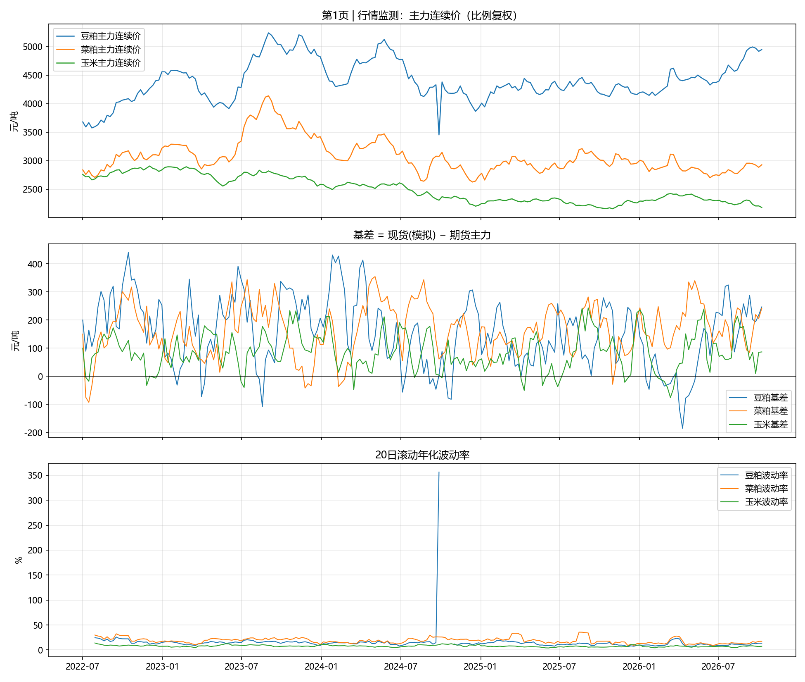

**第 2 页 成本与剪刀差**：固定 vs 动态配方吨成本、饵料成本占鱼价比及历史分位、敏感度对比。
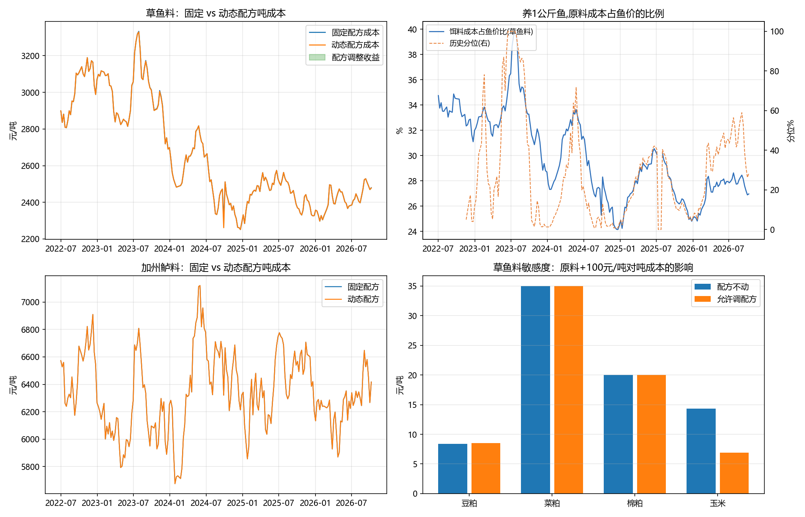

**第 3 页 预警与解读**：鱼料比价指数 + 20/50/80 分位线，跌破 20 分位自动标红预警。
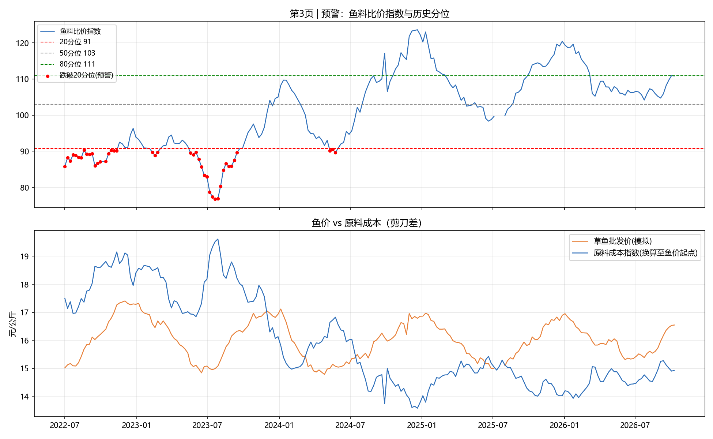

### 2.3 关键发现（数字均为本次实跑结果）

**① 敏感度——"原料涨 100 元，吨成本涨多少"**：

| 料种 | 原料 | 配方不动 | 允许调配方 | 动态调配方吸收 |
|---|---|---|---|---|
| 草鱼料 | 豆粕 +100 | +8.4 元/吨 | +8.5 元/吨 | ≈0 |
| 草鱼料 | 菜粕 +100 | +35.0 元/吨 | +35.0 元/吨 | ≈0 |
| 草鱼料 | **玉米 +100** | **+14.3 元/吨** | **+6.9 元/吨** | **51.7%** |
| 加州鲈料 | 豆粕 +100 | +35.1 元/吨 | +35.0 元/吨 | ≈0 |

解读：草鱼料的杂粕（菜粕/棉粕）用量已达抗营养因子上限，小幅涨价时没有替换空间——**配方调整的价值不在日常小幅波动，而在价差极端阶段**：2022-2026 年动态配方相对固定配方的周度收益多数周接近 0，但在 2024 年 9 月豆粕/菜粕价差极端时单周达到 **43.6 元/吨**。这与行业"靠调配方对冲原料涨价"的逻辑一致（协会口径 2025 年替代蛋白用量同比 +3.0%【待核年报转引】）。

**② 饵料成本占鱼价比**：最新一周（2026-10-09）草鱼料动态成本 2478 元/吨，按饲料系数 1.8 计，养 1 公斤鱼的原料成本占鱼价（16.1 元/公斤【模拟】）的 **27.0%**，处于 3 年滚动 58 分位。

**③ 比价低位后的走势**：鱼料比价指数跌破 20 分位（90.7）的时段共 4 次；其后 12 周内，**原料先回落 3 次、鱼价先回升 0 次**、都未发生 1 次——在本数据口径下，剪刀差修复主要靠原料回落而非鱼价上涨。（鱼价为模拟数据，此结论仅演示统计方法。）

**④ 领先滞后**：差分序列互相关显示原料价格变动领先鱼价约 **8 周**（豆粕 r=0.51，菜粕 r=0.34）。【说明：模拟鱼价内嵌了滞后 8 周的成本推动关系，用于演示方法；上线后需用真实批发价重新估计，且相关不等于因果。】

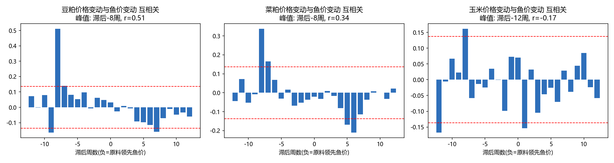

**⑤ 套保回测**（方法演示，不构成比例建议）：滚动 26 周最小方差套保比例均值 0.92；相对不套保，套 50% 比例使周度采购成本方差下降 46%（豆粕）/43%（菜粕），按最优比例下降 **62%**/55%，套 100% 与最优比例接近。未计入保证金占用与手续费；基差风险：现货为模拟均值回复基差，真实基差波动可能降低效果。

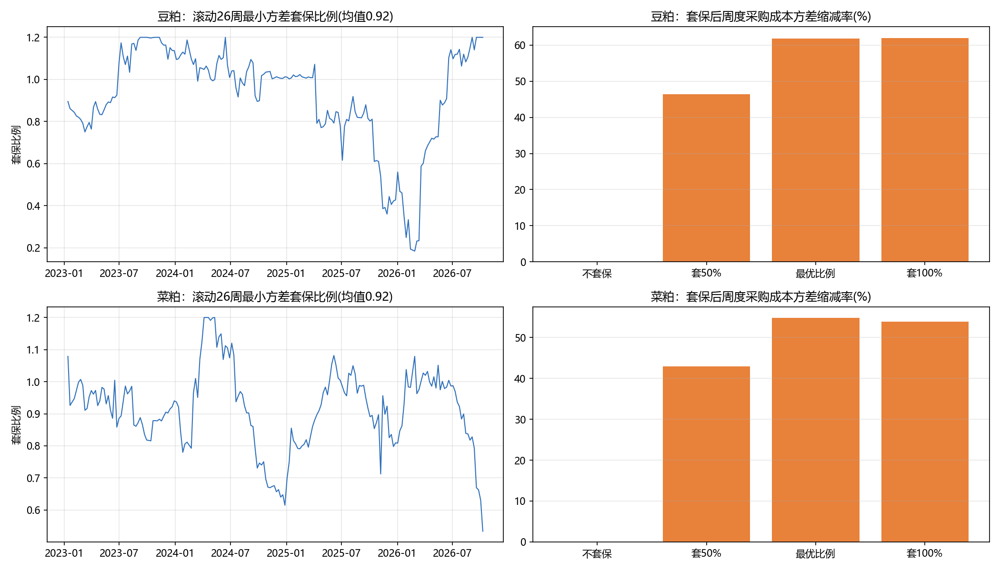

### 2.4 上线方案

公司内落地时：用 ERP 采购入库价替换公开现货价、用配方系统实际配方替换模型配方；指标口径与采购/财务/技术部门对齐；数据每日更新、看板每周自动刷新并监控数据质量（完整率/及时性指标已在字典中）。

---

## 三、P2 原料进厂 NIR 快检

### 3.1 数据

Eigenvector Research 公开玉米 NIR 数据集（原始数据来自 Cargill）【✅ 真实】：80 个样本 × 3 台仪器（m5/mp5/mp6）× 700 个波长点（1100-2498nm，间隔 2nm），4 项化验参考值（水分/油/蛋白/淀粉），附 NBS 玻璃标样。MATLAB DataSet 对象已用 scipy 解析转为 npz。

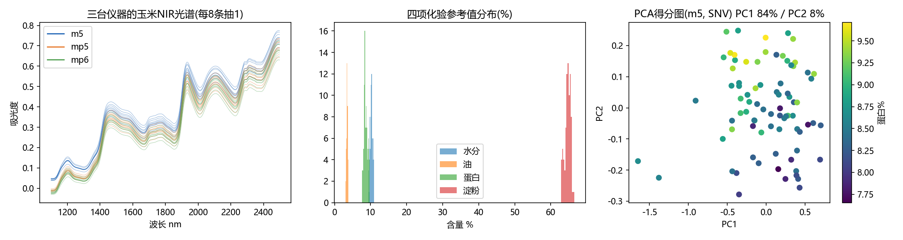

### 3.2 建模与评价

方法纪律：Kennard-Stone 划分 60 训练/20 测试；预处理只在训练集内交叉验证选择；PLS 潜变量用"一倍标准误规则"防过拟合；另做 20 次随机划分报告误差分布；随机森林作对照。

**模型对比（测试集，最优组合加粗）：**

| 指标 | 最优预处理 | 模型 | RMSEP | R² | RPD |
|---|---|---|---|---|---|
| 水分 | SG 一阶导数 | PLS(13LV) | **0.016** | 0.998 | **22.0** |
| 蛋白 | SG 一阶导数 | PLS(7LV) | **0.071** | 0.974 | **6.4** |
| 油 | SG 一阶导数 | PLS(10LV) | **0.037** | — | **4.5** |
| 淀粉 | SNV+SG 一阶导数 | PLS(10LV) | **0.101** | — | **8.1** |
| （对照）蛋白 | SG 一阶导数 | 随机森林 | 0.142 | 0.897 | 3.2 |

20 次随机划分下蛋白 RMSEP 稳定在 0.07-0.12 区间（见分布图）。下一步需用 GB/T 6432（凯氏定氮）与 GB/T 18868 的重复性限核实"模型误差相对化验误差"的倍数【待核】。VIP 得分高波段落在水（1450/1940nm）、蛋白（~2060/2180nm）、油（~1720/2310nm）已知吸收带附近，模型学到的光谱区域合理。

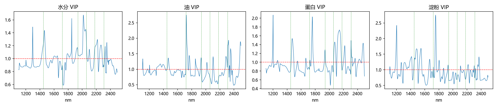
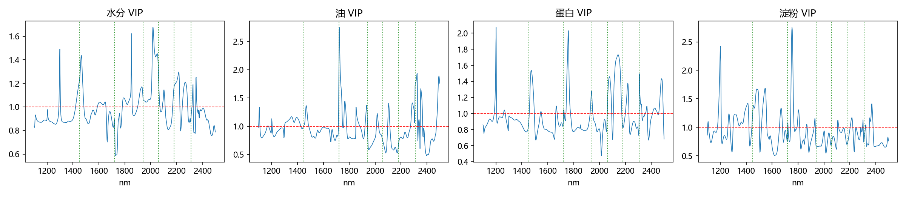

### 3.3 异常样本拦截

用 PCA 的 Hotelling T² 与 Q 残差设 95%/99% 双控制限。人为构造三类异常各 10 个：噪声污染、基线漂移、混入另一台仪器光谱。**拦截率 100%（30/30），正常样本误报率 0%（0/20）**。超限样本不出结果、转送化验室——这是"仪器不出错结果"的底线机制。

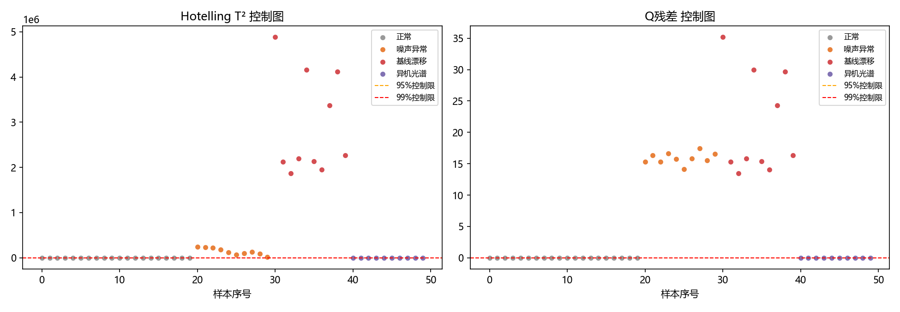

### 3.4 仪器间转移（多工厂管理问题）

m5 主机的蛋白模型直接用于 mp5/mp6，RMSEP 从本机 0.071 放大到 **1.03 / 1.26**（不可用）；取 10 个转移样本做斜率/截距校正（SBC）后降回 **0.17 / 0.15**。结论：各厂仪器不用各自重建模型，主机建模 + 少量转移样本校正即可统一；PDS 写入下一步。

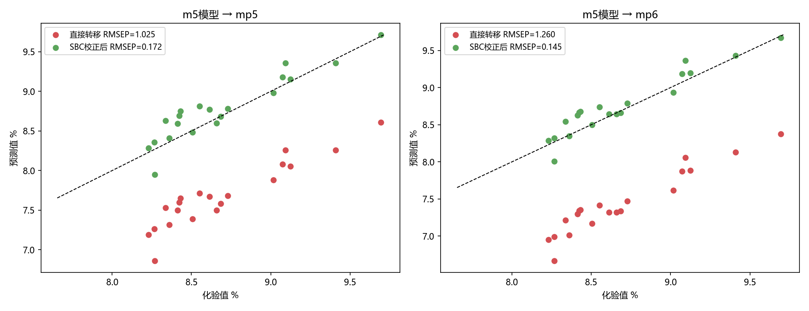

### 3.5 省钱测算（"测得准值多少钱"）

逻辑：无逐车快检时配方师按典型值配方，为保证成品蛋白达标需留安全余量（z×批次间波动）；有快检后不确定性收窄到模型误差，余量收窄。以玉米计（草鱼料中占 14.4%）：

- 批次间蛋白波动 std = 0.50 个百分点 → 快检后 RMSEP = 0.071 个百分点；
- 成品蛋白不确定性 0.072 → 0.010 个百分点，余量（z=1.28）从 0.092 收窄到 0.013；
- 配方 LP 两种余量下吨成本之差 = **0.97 元/吨**（与"蛋白影子价格×余量变化"快速估算 0.97 元/吨完全一致，交叉验证通过）；
- 年产 5万/20万/50 万吨假设下，年节约 **4.8 / 19.3 / 48.3 万元**。

**必须注明**：玉米主要提供能量、蛋白占比小，此测算偏保守；换豆粕/菜粕/鱼粉需用真实光谱数据重新建模。另两项收益（按质论价升贴水、拒收不合格批次）只给公式与情景。

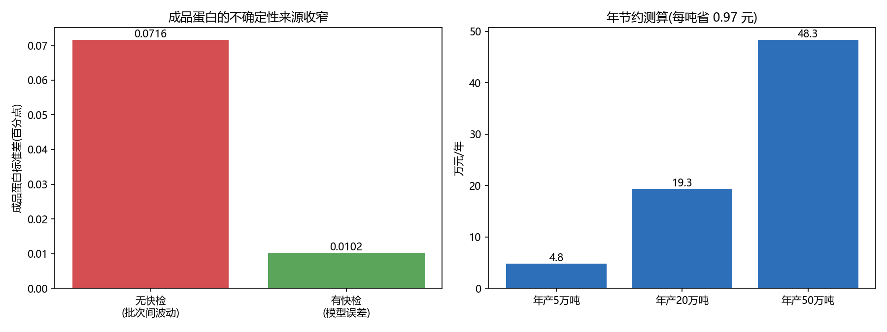

### 3.6 局限与上线方案

局限：仅 80 样本（工业样本库通常大得多）、单一原料、未覆盖霉变掺假。上线：化验结果定期回传更新模型；主机建模+各厂转移校正；接入化验室系统与 ERP，按批次号串起"进厂检测→配方取值→成品批次"的质量追溯链；每月抽样比对画控制图，超限报警。

---

## 四、P3 水产饲料旺季生产、库存与配送优化

### 4.1 需求测算

年需求 = 养殖产量 × 饲料系数 × 配合饲料使用率 × 服务份额 = 170 万吨【待核年鉴】×1.8×55%×30% ≈ **50.5 万吨**（鲢鳙等滤食性鱼不喂配合饲料，已在使用率口径中剔除）。月度分布用成都 2025 年真实日气温（Open-Meteo）驱动投喂曲线（<12℃ 停喂、12-28℃ 线性上升）：**7 月峰值占 17.5%，12-2 月接近 0**——旺季一个月要吃掉近两个月的均衡产能，这就是 P3 要解决的问题。

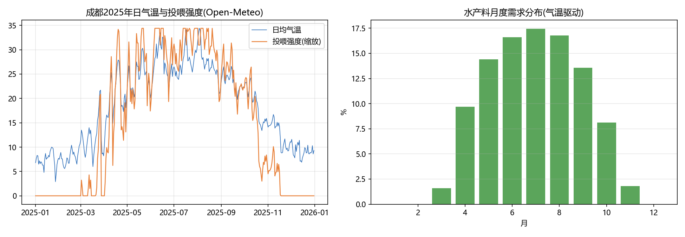

### 4.2 运输成本模型与现状诊断

自下而上：车公里成本 = 油费 2.25（柴油 7.5 元/升×百公里 30L）+ 过路 2.0 + 司机 0.8 + 折旧保险 0.7 = **5.75 元/公里**；30 吨载重、回程空车率 50% → **0.287 元/吨·公里**（参数来自本人物流经验+公开规则，A-TRC-01）。就近供货下：加权平均配送距离 100 公里，平均服务成本 28.9 元/吨；**泸州每吨服务成本 74 元，是全区平均的 2.6 倍**。

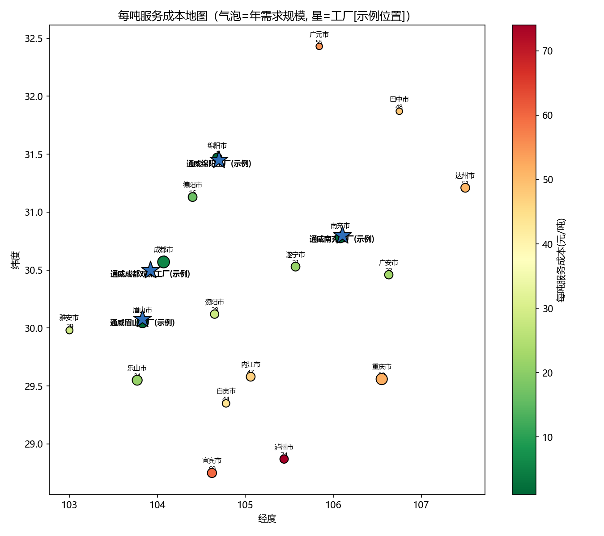

### 4.3 模型 A：多月份生产-库存-运输统筹（LP）

12 个月 × 4 工厂 × 2 产品线（颗粒/膨化分开约束产能）× 18 个需求点，决策产量/库存/发运/厂间调货/缺货，目标总成本最低。保质期简化为"库存 ≤ 未来 2 个月需求"。

| 策略 | 总成本(万元/年) | 旺季缺货(吨) | 库存周转天数 | 峰值产能利用率 |
|---|---|---|---|---|
| ①按订单生产+就近供货 | 9213 | 118,809（23.5%） | 0 | 100% |
| ②允许提前生产 | **7335** | **26,916（5.3%）** | 22.7 | 100% |
| ③允许工厂间调货 | 9213 | 118,809 | 0 | 100% |
| ④提前生产+调货 | **7335** | **26,916（5.3%）** | 22.7 | 100% |

**结论**：
- 允许提前生产后，旺季缺货下降 **77%**，总成本下降 **20%**；代价是淡季库存周转从 0 增至 22.7 天——**这个"用淡季的库存占用换旺季的缺货损失"的取舍，正是产销协调会要拍的板**。
- 常态下调货无收益（③=①）：各厂产品结构与需求节律相同，旺季同步满负荷，谁也帮不了谁；**调货的价值在应急**——"成都厂 8 月停产两周"情景中，调货机制把缺货控制在 +7500 吨（成本 +382 万），若无调货缺货会更糟。
- **旺季产能影子价格 255-417 元/吨**（8 月各产线）：8 月每多一吨产能价值约 255-417 元，可直接用于评估加班、外包加工或扩产线是否划算。

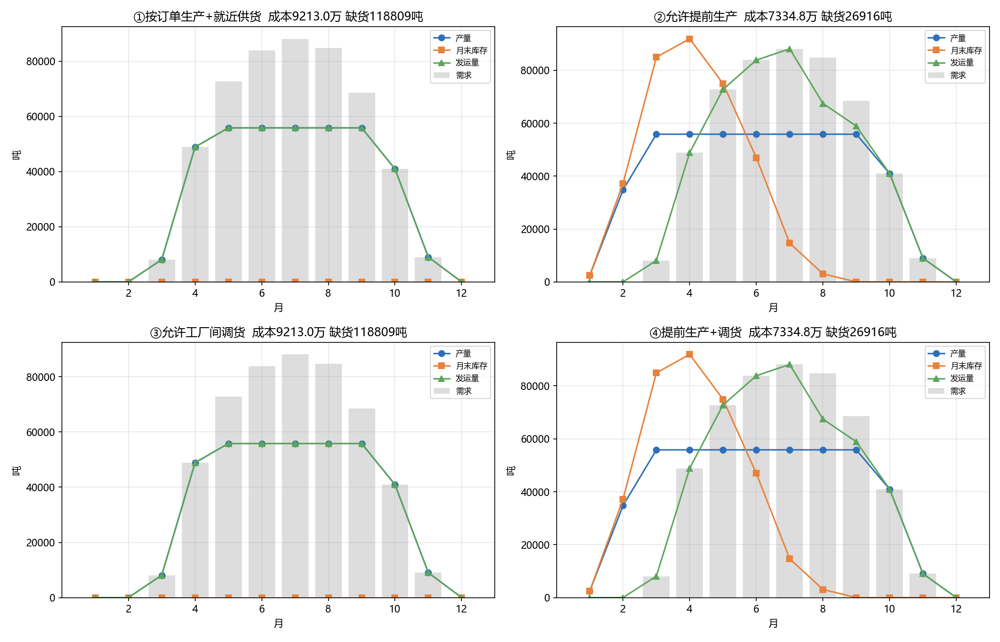

**情景表**（叠加在策略④上）：柴油 +10% → 成本 +62.5 万（+0.9%，运费占比可控）；成都厂停产两周 → +382 万；需求 +15% → +2745 万且缺货升至 7.6 万吨（产能硬瓶颈，需提前锁产能/外包）。

### 4.4 模型 B：旺季单日派车排线（模拟订单【A-ORD-01】）

成都厂 8 月某日 36 单 270 吨，车辆载重 30 吨、日驾时 11 小时、送货时间窗：

| 派车方式 | 车次 | 总里程 | 装载率 | 每吨成本 | 按时送达率 |
|---|---|---|---|---|---|
| ①一单一车直送 | 36 | 1571 km | 25% | 73.4 元 | 100% |
| ②片区固定线路 | 11 | 972 km | 82% | 32.9 元 | 98.9% |
| ③拼车优化(Clarke-Wright) | **10** | **592 km** | **90%** | **23.7 元** | 100% |

**拼车比直送少用 72% 的车次，每吨配送成本从 73.4 降到 23.7 元**。小单临界分析：直送每吨成本随吨位快速上升，**小于约 6 吨的订单应拼车或改客户自提**（6 吨直送每吨 280 元）。

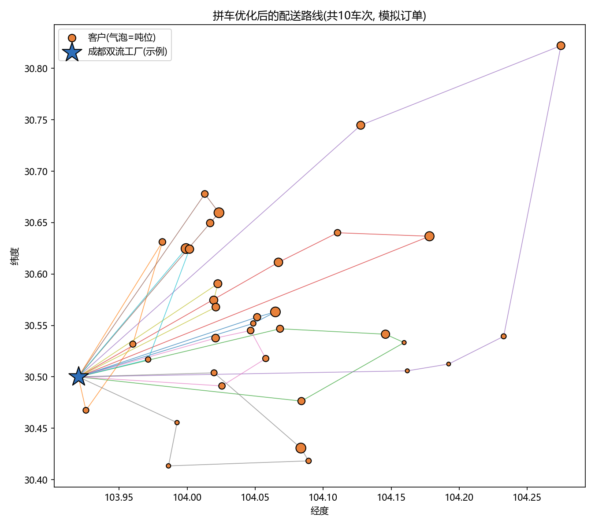

### 4.5 物流指标看板页 + 上线方案

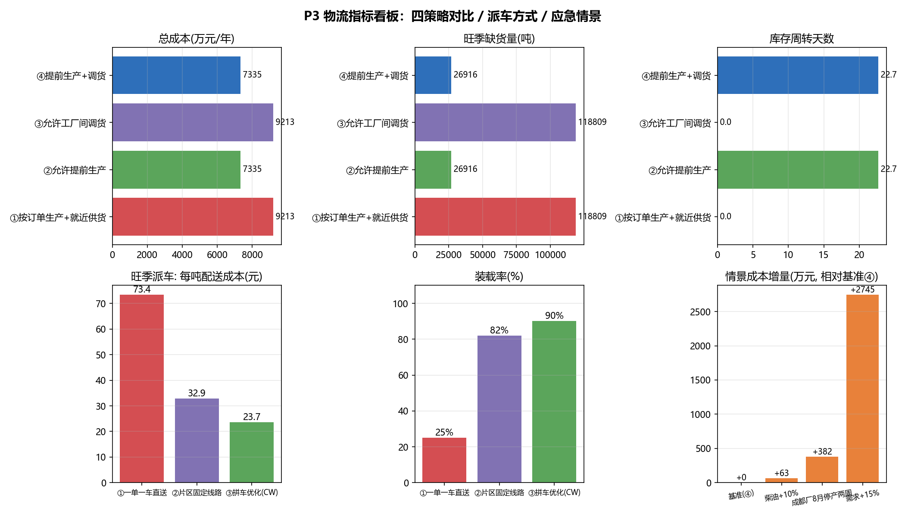

补充口径（覆盖 JD"生产损耗"，只定口径不取数）：生产损耗率 =（投入原料量 − 合格成品量 − 可回用料）÷ 投入原料量，须区分干物质口径与实物重量口径（调质/烘干改变水分）；运输仓储损耗按破包/受潮/霉变分别计量。

上线：用 TMS 运单、WMS 库存、ERP 订单发货、MES 产量替换模拟数据与假设；模型每月滚动更新供产销协调会使用；排线接调度系统辅助派车。面试前应确认通威水产料交付方式（经销商自提/工厂送货/第三方物流），模型中交付方式已做成可切换参数。

---

## 五、面试主线与简历写法

主线一句话："我按饲料供应链的三个环节做了作品集——**买、验、送**：P1 监测原料成本和鱼价，用配方模型算出原料涨价对吨成本的真实影响；P2 用近红外快检把进厂原料测准，并算出测准值多少钱；P3 结合我的物流经历，做水产料旺季的生产、备货和配送优化。三个作品共用一套数据底座、一本指标字典和一个配方模型。"

## 六、数据核实清单状态

| 状态 | 数据项 |
|---|---|
| ✅ 已落实为真实数据 | 豆粕/玉米/菜粕期货日线（tushare）、玉米 NIR 数据集（Eigenvector/Cargill）、成都 2025 日气温（Open-Meteo） |
| 【模拟，待替换】 | 现货基差（生意社接口待核）、草鱼批发价（农业农村部系统待核）、鱼粉价格（付费平台）、订单 |
| 【假设，待核】 | 工厂名单产能（官网/环评公示）、饲料系数与使用率、运输成本参数（部分为本人经验）、营养标准编号（GB/T 6432、GB/T 18868、草鱼料行业标准）、保质期口径（GB 10648） |

*本报告所有数字均可复现：运行顺序见 README.md。*
